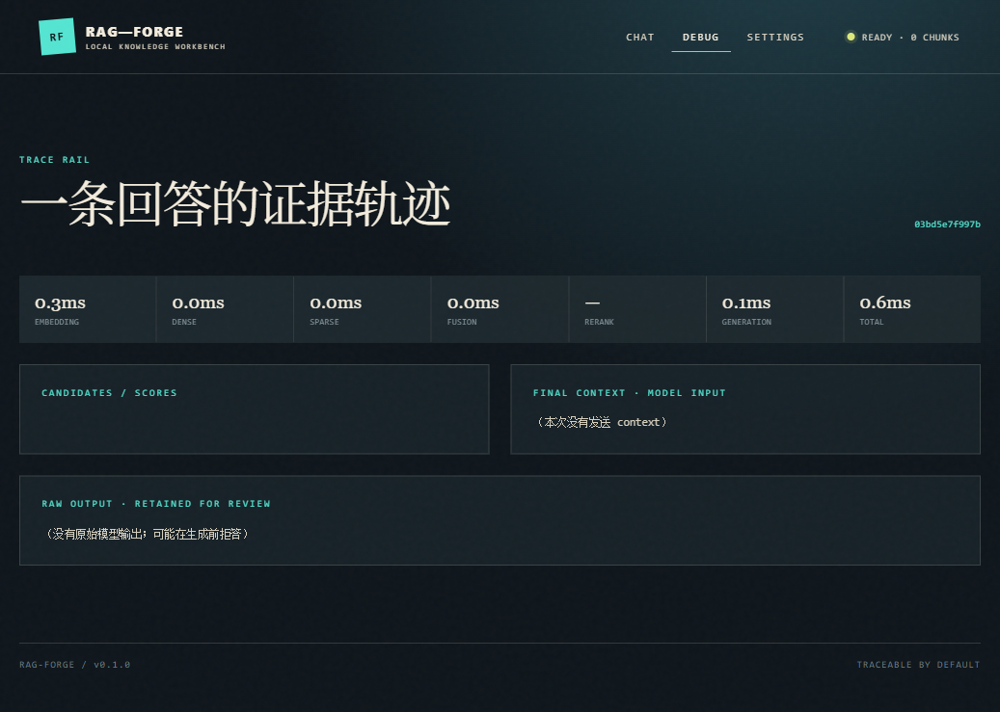

# RAG-Forge

可评测的检索增强问答引擎：标题感知分块 + 稠密/BM25 混合检索 + RRF 融合 + 可选 CrossEncoder 重排 + 证据驱动生成（不足即拒答）+ 量化评测。

- **技术栈**：Python >=3.10 · FastAPI · Qdrant(或 InMemory) · Ollama(bge-m3) · rank_bm25 · 可选 CrossEncoder 重排 · pytest
- **生成/嵌入**：默认通过本机 Ollama 使用 `gemma3:4b` 和 `bge-m3`；旧 OpenAI 兼容服务必须显式设置 `RAG_GENERATION_BACKEND=api`。
- **数据/模型全部可选开源**：Ollama 本地模型 + `bge-reranker` 重排，离线可用、零 API 费用。

## 当前状态

项目当前是本地 Beta，可继续开发和本机运行，但不是正式发布版本。最近一次工作树核对（2026-09-19）为 `243 passed, 2 skipped`、Ruff 通过、`pip check` 通过；只读发布门禁仍为 `BLOCKED`，原因是许可证文本、人工 Golden Set 和冻结 split 尚未补齐。

快速了解架构和运行边界见 [`CONTEXT.md`](CONTEXT.md)，只看未完成事项见 [`TODO.md`](TODO.md)，完整文档导航见 [`docs/README.md`](docs/README.md)，阶段证据见 [`docs/reports/final-acceptance.md`](docs/reports/final-acceptance.md)。候选 benchmark 结果均为 provisional，不能当作正式质量指标。

## 目录结构

```text
rag-forge/
├── src/ragforge/
│   ├── config.py / models.py / embeddings.py / vectorstore.py / grounding.py / generator.py / pipeline.py
│   ├── ingest/        # 解析、语义分块
│   ├── retriever/     # 稠密、BM25、RRF 融合、重排
│   ├── evaluation/    # Hit@K/Recall@K/MRR + 忠实度代理指标
│   ├── api/           # FastAPI（含受保护 Trace 查询）
│   └── observability/ # 结构化日志 + trace
├── scripts/           # 数据、评测、Windows 原生启停与 smoke
├── benchmarks/        # candidate / golden 数据集规则与实验说明
├── tests/             # 单元测试（离线）
├── data/raw/docs/     # 知识库语料（放入 md/txt/pdf/html）
├── docker-compose.yml + Dockerfile
└── .env.example
```

## 架构与数据流

```text
文档/URL → 清洗与标题感知分块 → embedding → Qdrant/InMemory
                                      ↘ SQLite Manifest（来源、hash、版本、active）
问题 → 可选 Query Rewrite（只改检索词） → Dense + BM25 → RRF → 可选本地 Rerank
     → context 预算与 Citation 编号 → Ollama Gemma 生成 → 拒答/引用校验 → Trace/API/UI
```

Embedding（默认 `bge-m3`）负责把问题和 chunk 映射到向量空间；BM25/RRF 补充精确词命中；Gemma 只负责基于已选 evidence 生成答案；Citation、工程拒答和 Trace 负责暴露证据边界，不把检索分数当作概率。

## 快速开始

```powershell
python -m venv .venv
$python = ".\.venv\Scripts\python.exe"
& $python -m pip install -e ".[vector,dev]"
if (-not (Test-Path .env)) { Copy-Item .env.example .env }
# 已有对应 Windows 锁文件时，也可用：.\scripts\install_locked.ps1 -Profile vector-dev

# 本地生成模式需要先启动 Ollama，并确认 gemma3:4b / gemma4:e4b 已安装
# 请另开一个终端运行：ollama serve

# 1) 拉取评测子集（MLQA 英-中；需要安装 data extra）
& $python -m pip install -e ".[data]"
& $python -m scripts.fetch_data --mlqa 100

# 2) 摄入语料（把科技文档放入 data/raw/docs/ 后）
& $python -m scripts.ingest_docs data/raw/docs

# 2.1) 采集官方文档并增量写入 Qdrant（维护窗口内停止 API）
# 可选总时限避免批量采集长时间无反馈；到时保留已成功结果并在报告中标记
& $python -m pip install -e ".[collector]"
& $python -m scripts.fetch_sources --config configs/sources.yaml --max-pages 10 --max-seconds 120
& $python -m scripts.update_knowledge --config configs/sources.yaml --max-pages 10 --max-seconds 120

# 3) 离线 smoke（不依赖网络/模型，验证链路）
& $python -m scripts.smoke

# 4) 评测：检索层指标 + 检索策略消融
& $python -m scripts.run_eval data/raw/mlqa_en_zh.jsonl 10

# 5) Windows 原生启动（推荐，带 PID/端口/readiness 检查）
.\scripts\start.ps1
.\scripts\status.ps1
# 浏览器访问 http://127.0.0.1:8000；结束时：
.\scripts\stop.ps1

# 其他系统或手动启动 API
& $python -m uvicorn ragforge.api.main:app --reload

# 6) 或 Docker 一键起（Qdrant + API；基础 Compose 使用 OpenAI-compatible 生成后端，需在 .env 配置 key）
docker compose up --build
#    服务地址：API http://localhost:8001（宿主机 8000 常被 Docker 内部占用，已改映射 8001）
#    qdrant  http://localhost:6333

# 6.1) Docker Desktop + 宿主机 Ollama（使用 host.docker.internal，不要填 127.0.0.1）
docker compose -f docker-compose.yml -f docker-compose.ollama.yml up --build
# 如果宿主机已运行 Qdrant 6333，可用临时宿主端口并行启动：
$env:RAGFORGE_QDRANT_HOST_PORT = "16333"
$env:RAGFORGE_API_HOST_PORT = "18002"
docker compose -f docker-compose.yml -f docker-compose.ollama.yml up --build
```

本地生成/嵌入配置使用 `RAG_GENERATION_BACKEND=ollama`、`RAG_EMBEDDER_BACKEND=ollama`、
`RAG_OLLAMA_BASE_URL`、
`RAG_DEFAULT_GENERATION_MODEL` 和 JSON 数组形式的 `RAG_ALLOWED_GENERATION_MODELS`。
服务启动后可用 `GET /api/models` 查看实际已安装且允许使用的模型。规范问答入口是
通过 `POST /api/chat` 的 `generation_model`、`retrieval_mode`（`dense` / `hybrid` / `hybrid_rerank`）和 `top_k` 字段按请求选择模型与检索模式；请求不会修改共享模型状态，
也不会因客户端传入未知模型而自动下载模型。若只验证离线检索链路，运行
`python -m scripts.smoke`，它会显式使用 deterministic + offline 配置。

`/ask` 和 `/query` 仍保留用于兼容旧客户端；其中 `/query` 主要返回检索调试结果。新代码和新文档应优先使用 `/api/chat`。

`POST /api/chat` 返回的 `citation_details` 只来自实际发送给模型的证据，引用编号越界或缺失时会拒答；
`citation_support_status` 在当前版本默认为 `unverified`，有效编号不等于人工确认了事实支撑。
可用 `GET /api/traces/{trace_id}` 查看受保护的检索、生成和证据追踪信息；Trace 默认最多保留 100 条、1 小时，
且不会在普通日志中输出问题全文或上下文全文。未完成独立标注校准前，拒答模式显示为工程规则/`uncalibrated`，
不会把 RRF 排名或 raw CrossEncoder 分数伪装成概率。

Query Rewrite 已作为可选能力接入，默认关闭；勾选后由 `qwen3:0.6b` 只生成检索查询，原问题仍用于最终回答。
utility 模型不可用、输出为空、过长、包含 `<think>`/结构化包装、增加数字事实或丢失错误码/版本时会回退原问题，
并在 Trace 中记录 `applied` / `fallback`、原因和耗时。改写不会触发重新索引。

API 的 `/ingest` 只接受 `RAG_INGEST_ROOT` 目录内的文件路径，默认根目录为
`data/raw/docs`；请求中的相对路径相对于该目录解析，不允许通过 `..` 读取其他本地文件。
单个文件默认限制为 10 MiB，可通过 `RAG_MAX_INGEST_BYTES` 调整。
请求体默认限制为 128 KiB，单次摄入文件总量默认限制为 32 MiB；可通过
`RAG_MAX_REQUEST_BODY_BYTES`、`RAG_INGEST_TOTAL_BYTES` 调整。默认 Host 仅允许本机地址；
使用 `scripts/start.ps1 -HostAddress` 绑定非 loopback 地址时必须配置 `RAG_API_KEY`。

配置 `RAG_API_KEY` 后，所有 API 请求都必须携带 `X-API-Key` 请求头；
`RAG_RATE_LIMIT_PER_MINUTE` 默认按客户端地址限制为每分钟 60 次。
生产环境不要将 API 暴露到公网而不配置 API key、反向代理认证和 TLS。

## 评测指标（如实记录）

- 检索层：`Hit@K` / `Recall@K` / `MRR`
- 生成层：`faithfulness` / `citation_support`（当前为**确定性 token 覆盖代理**，标注为参考值；权威评测请用 RAGAS）
- 拒答/可追溯：有效 Citation 映射、越界拒答、`refusal_reason`、受保护 Trace；独立校准前标记 `uncalibrated`
- 消融：`纯稠密 vs 稠密+BM25(RRF) vs +重排`、分块大小 x 召回 x 延迟

> 原则：用真实跑出的数字说话，不虚报；离线回生成器仅用于检索演示，不计入生成层评测。

## Golden Set 与实验

M9 的候选集生成与实验脚本见 [`benchmarks/README.md`](benchmarks/README.md)。当前候选集仅用于管线试运行，尚未人工审核，不能当作 Golden 结果。
正式运行必须使用人工审核后的 `benchmarks/golden.jsonl`；候选试跑显式使用 `--allow-candidate`，结果会标记 `provisional`。

```powershell
.\.venv\Scripts\python.exe -m scripts.build_golden_candidates
.\.venv\Scripts\python.exe -m scripts.run_benchmark --dataset benchmarks\candidates.jsonl --config configs\experiments.yaml --experiment retrieval --allow-candidate
```

## Windows Demo

五分钟验收脚本见 [`docs/DEMO.md`](docs/DEMO.md)。启动脚本会从 `$PSScriptRoot` 定位仓库，使用项目 `.venv`，检查自有进程和端口，并把运行状态/日志写入被 Git 忽略的 `data/run/`。

## 数据来源（开源/开放，个人用途）

- **评测集**：`xtreme/MLQA.en.zh`（HuggingFace）、BEIR、MS MARCO
- **语料**：arXiv(AI/ML，open-access)、开源项目文档（MIT/Apache）——放 `data/raw/docs/`
- **模型**：`BAAI/bge-m3`、`BAAI/bge-reranker-base`（北京智源，开源）

## 历史评测结果（仅存档，不是当前 Ollama M9 指标）

> 数据：`MLQA.en.zh`（英文问题 + 中文长文段）取 100 条；按唯一 context 去重为 80 篇文档，每问以其所属文档为检索目标。评测命令：
> `python -m scripts.run_eval data/raw/mlqa_en_zh.jsonl 10`

| 阶段 | 指标 | dense_only | hybrid(+BM25/RRF) |
|---|---|---|---|
| 检索层 | Hit@10 | 0.94 | 0.94 |
| 检索层 | Recall@10 | 0.94 | 0.94 |
| 检索层 | MRR | 0.86 | 0.86 |
| 生成层 | faithfulness（确定性 token 覆盖代理） | 0.11 | — |
| 生成层 | citation_support（代理） | 0.11 | — |
| 生成层 | refusal_rate | 0.45 | — |

说明：
- **检索层**：80 篇文档单文档命中，Hit/Recall@10=0.94、MRR=0.86。该口径下纯稠密 vs 混合差异不显著——bge-m3 稠密召回已覆盖正确文档，BM25 在无专用名词的跨语言问句上未带来额外增益。
- **生成层 0.11 为代理指标**（答案 token 被证据覆盖比例）：对短摘答型 MLQA 偏严、且拒答样本按 0 计入均值，是近似值，不代表真实忠实度；权威评测用 RAGAS 语义化指标。
- **旧版 refusal_rate 0.45 只保留为历史结果**：当前 M6 不再把 bge-reranker 的 raw 输出直接宣称为 0~1 概率，也不把 RRF 排名当置信度；需要独立标注集校准后才能发布新的概率阈值结果。

## 路线图（MVP）

- [x] M1 摄取闭环（解析+分块+embedding+入库）
- [x] M2 检索基线（稠密 + 指标）
- [x] M3 混合检索（BM25/RRF，含消融脚本）
- [x] M4 生成+拒答+引用（实现与集成证据）
- [x] M5 工程化收尾：完成 bge-reranker 重排、扩大评测样本至 100 条、落地 Docker
- [x] M6 Citation、工程拒答、Trace
- [x] M7 原生 Web UI
- [x] M8 可选 Query Rewrite（默认关闭，失败回退原问题）

当前 M9 候选集和 provisional 结果见 [`docs/reports/M9-benchmark.md`](docs/reports/M9-benchmark.md)；其中 20 条真实 Ollama 双模型采样已完成，但 `benchmarks/golden.jsonl` 仍需人工审核后才能形成正式指标。

总体逐阶段验收表见 [`docs/reports/final-acceptance.md`](docs/reports/final-acceptance.md)。
新机器安装、开发验证、备份恢复和发布门禁见 [`docs/LOCAL-SETUP.md`](docs/LOCAL-SETUP.md)、
[`docs/DEVELOPMENT.md`](docs/DEVELOPMENT.md)、[`docs/BACKUP-RESTORE.md`](docs/BACKUP-RESTORE.md)
和 [`docs/RELEASE.md`](docs/RELEASE.md)。

## UI 截图


